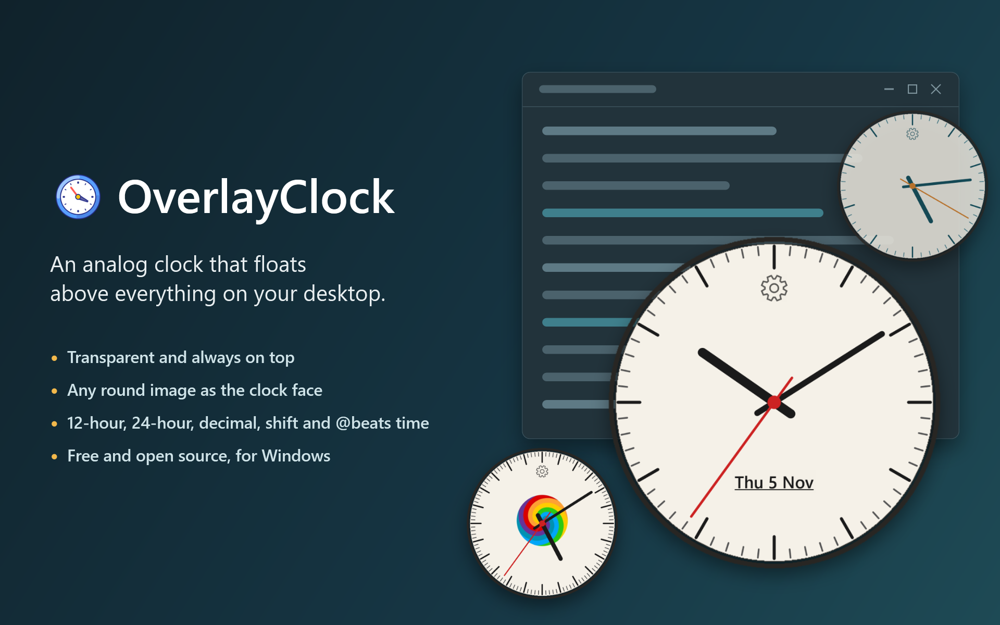

# OverlayClock

[](https://github.com/kreaton/OverlayClock/releases/latest)
[](LICENSE)




**A transparent, always-on-top analog clock overlay for Windows.**

OverlayClock puts just the dial and hands on your desktop, with no window frame around them, and keeps them above your other windows. Drag the clock anywhere and set its size and opacity to suit.

The clock face is a **replaceable image file**. Hands and tick marks are drawn on top of it, so you can use any round dial graphic without recompiling. The clock can also run on 24-hour, decimal, shift or Swatch @beats time, or on a time system you define yourself. It's built with WPF on .NET 10.

## Features

| Feature | Detail |
|---|---|
| **Replaceable face** | PNG, JPG, BMP or GIF; the overlay scales to match the image |
| **Multiple time systems** | 12-hour, 24-hour, Decimal 10-hour, Industrial 6-hour, Swatch @beats |
| **Custom time system** | Define your own hours/day, minutes/hour, seconds/minute, ticks and rotations/day |
| **Scalable** | 10 % to 200 % of the image's native resolution |
| **Always on top** | Toggle from the context menu or Settings |
| **Window opacity** | 10 % to 100 % |
| **Tick marks** | Show or hide major and minor ticks, each with its own colour |
| **Hand colours** | Separate hex colour for each hand |
| **Hand thickness** | Separate multiplier for each hand (0.3× to 3×) |
| **Time zone** | Any system time zone |
| **Date** | Optional weekday, day and month on the lower part of the face, with its own colour; click it to open your calendar |
| **Settings cogwheel** | One click on the cogwheel just below the top of the face opens Settings |
| **About** | Version and credits at the bottom of the Settings window |
| **Persisted settings** | Saved to `%APPDATA%\OverlayClock\settings.json` |

## Requirements

- Windows 10 or 11
- [.NET 10 SDK](https://dotnet.microsoft.com/download/dotnet/10.0)

## Building and running

Run these from the repository root, which contains `OverlayClock.slnx`:

```batch
dotnet build OverlayClock.slnx -c Release
dotnet run --project OverlayClock
```

To publish a self-contained build that doesn't need .NET installed:

```batch
dotnet publish OverlayClock -c Release -r win-x64 --self-contained true -p:PublishSingleFile=true
```

The output goes to `OverlayClock\bin\Release\net10.0-windows\win-x64\publish\`. Keep the folder's contents together: the EXE needs the native WPF DLLs beside it, and it loads the default clock face from the `Assets` folder.

## Releases

Every push to `main` builds the app on GitHub Actions and publishes a new release, one patch version higher than the last (`.github/workflows/release.yml`). Installed copies pick it up through right-click → Check for updates…. You can also start a release by hand from the repository's Actions tab.

## Usage

| Action | How |
|---|---|
| **Move** | Left-click and drag anywhere on the clock |
| **Settings** | Click the cogwheel, double-click the clock, or right-click → Settings… |
| **Show the date** | Settings → Appearance → Show date on clock face |
| **Open your calendar** | Click the date. This starts the app Windows uses for `.ics` files, which may not open on its calendar view |
| **Toggle always on top** | Right-click → Always on Top |
| **Exit** | Right-click → Exit |

## Using a custom clock face

1. Prepare a **square PNG** with a round dial on a **transparent background**. Use at least 256 × 256 px; 512 × 512 or higher gives the best results.
2. Open Settings, choose **Browse…** and select your image.
3. Adjust the **Scale** slider. Scale is relative to the image's pixel size.

Ticks and hands are centred on the image automatically. If your face already has printed tick marks, turn off the major and minor tick marks in Settings.

## Time systems

| Mode | Hours/day | Minutes/hour | Seconds/minute | Hour hand rotations/day |
|---|---|---|---|---|
| Standard 12-hour | 12 | 60 | 60 | 2 |
| 24-hour (Military) | 24 | 60 | 60 | 1 |
| Decimal 10-hour (French Revolutionary) | 10 | 100 | 100 | 1 |
| Industrial 6-hour (shift clock) | 6 | 60 | 60 | 4 |
| Swatch @beats | 10 | 100 | 100 | 1 |
| **Custom** | Your choice | Your choice | Your choice | Your choice |

To use a custom system, expand **Custom time system…** in Settings and leave it expanded when you click OK.

## Settings file

`%APPDATA%\OverlayClock\settings.json` is human-readable JSON. Edit it while the app is closed to set values outside the slider ranges, or options that aren't in the Settings window, such as `CenterDotColor`.

## Project structure

```
OverlayClock.slnx
README.md
images/
└── banner.png                    picture at the top of this README
OverlayClock/
├── Assets/
│   ├── clock.ico                 application icon
│   ├── clockface_default.png     bundled dial
│   └── clockface_spiral.png/.xcf alternative dial and its GIMP source
├── Models/
│   ├── ClockMode.cs              time system definitions and angle math
│   └── ClockSettings.cs          persisted preferences
├── Services/
│   └── CalendarLauncher.cs       finds and opens the default calendar app
├── Views/
│   ├── MainWindow.xaml/.cs       transparent overlay and rendering
│   └── SettingsWindow.xaml/.cs   settings panel
├── App.xaml/.cs
└── OverlayClock.csproj
```
